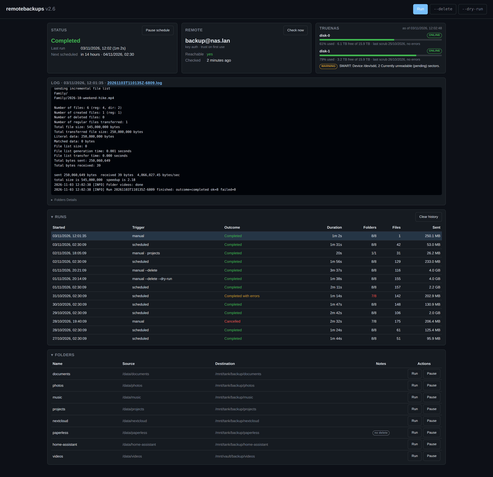
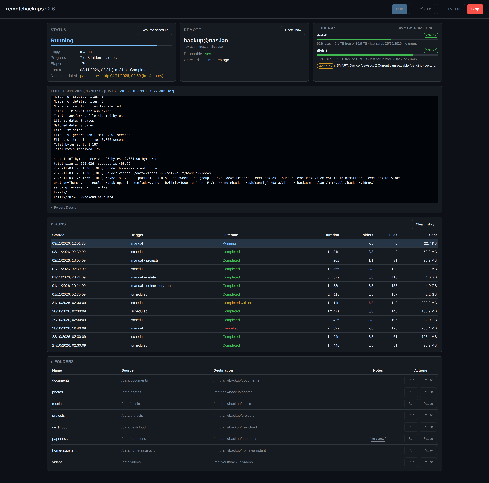
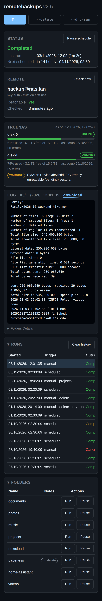

# remotebackups

Scheduled rsync backups of your home-server folders to another host, with a web UI.
Source, releases and changelog: https://github.com/EduOnieva/remotebackups.
The [wiki](https://github.com/EduOnieva/remotebackups/wiki) has the longer guides: destinations,
reverse proxies, troubleshooting, the API and restoring.

One container. Mount the folders, point it at a host you can SSH into, and it keeps a copy
there: on a schedule, or when you press **Run**. The destination can be anything with `sshd`
and `rsync`: a NAS (TrueNAS gets extra status), a second server at a friend's place reached
through Tailscale, or a machine on your LAN.

- **Scheduled and manual runs.** A cron expression for the schedule, a Run button for now,
  and two toggles beside it: `--delete` when you want the backup to drop files you deleted
  locally, `--dry-run` to report what a run would do without doing it, both together to
  preview a deletion. The schedule, or a single folder, can be paused from the UI until the
  container restarts.
- **Stop.** A running backup can be stopped from the UI; rsync keeps partial files and the
  next run continues where it stopped.
- **Live log and history.** Every run has its own log, streamed live while it runs and kept
  for 40 days with what happened to each folder: files, bytes, exit codes explained.
- **Honest status.** `/healthz` for Docker, `/api/status` for your dashboards, and the SSH
  login is probed every five minutes so you see a sleeping NAS before a run fails.
- **Safe defaults.** Key authentication, host keys pinned on first use, rsync and ssh never
  see the application's secrets, and `--delete` is never part of a scheduled run. The compose
  files run the container read-only with every capability dropped but the two root needs to
  read your folders and write `/config`.
- **TrueNAS SCALE aware.** Optional card with each pool's usage, health and last scrub plus the
  current alerts, from the TrueNAS API; `/api/pool_status` keeps the v1 shape for dashboards.



*The dashboard after a week of runs: status, destination and TrueNAS cards, the last run's log, the run history and the folders with their Run and Pause buttons.*

## Quick start

1. Create a folder for the container's state. Your SSH private key stays where it is: the
   compose file below mounts that one file read-only at `/run/secrets/ssh_key`, the place the
   container looks by default.

   ```bash
   mkdir -p remotebackups/config
   ```

   The matching public key goes into the destination user's `authorized_keys` (on TrueNAS:
   the user's *Public SSH Key* field). The key must have no passphrase, since nobody is there
   to type it. A key used only for these backups is the safer choice:
   `ssh-keygen -t ed25519 -N "" -f ~/.ssh/remotebackups`, then mount that file instead.
   Compose's own `secrets:` feature also lands files in `/run/secrets`, so
   `secrets: {ssh_key: {file: /home/you/.ssh/id_ed25519}}` works without any other setting.

   Write the host path of the key in full. Compose expands `~` to the home of whoever runs the
   deploy, which is root under `sudo` or Portainer, and Docker turns a bind mount whose source
   does not exist into an empty directory. The UI then reports
   `No SSH key at /run/secrets/ssh_key`; `docker exec remotebackups ls -la /run/secrets` shows
   the directory.

2. Save a compose file next to it. For a destination you can reach directly:

   ```yaml
   services:
     remotebackups:
       image: eduonieva/remotebackups:latest
       container_name: remotebackups
       restart: unless-stopped
       stop_grace_period: 30s
       security_opt:
         - no-new-privileges:true
       cap_drop: [ALL]
       cap_add: [DAC_READ_SEARCH, DAC_OVERRIDE]
       read_only: true
       tmpfs:
         - /run/remotebackups
       ports:
         - "8080:8080"
       volumes:
         - ./config:/config
         - /home/you/.ssh/id_ed25519:/run/secrets/ssh_key:ro
         - /srv/documents:/data/documents:ro
         - /srv/photos:/data/photos:ro
       environment:
         - REMOTE_HOST=192.168.1.20
         - REMOTE_USER=backup
         - TZ=Europe/Madrid
   ```

   For a destination reached through Tailscale, use
   [`docker-compose.tailscale.yaml`](docker-compose.tailscale.yaml): the app runs behind the
   official Tailscale sidecar, and the UI is then reachable only from your tailnet.

3. `docker compose up -d`. The first start writes a commented `config/config.yaml`. Add the
   folders to back up and they are picked up before the next run, no restart needed:

   ```yaml
   folders:
     - source: /data/documents
       destination: /mnt/backup/documents
     - source: /data/photos
       destination: /mnt/backup/photos
   ```

4. Open `http://<host>:8080`, press **Run**, watch the log.

## The web UI

The page shows the current state with progress during a run, the last and next run, whether
the destination is reachable (with a **Check now** button), the TrueNAS card when enabled, the
log of the selected run with a folded table of what happened to each of its folders, and the history
of runs and the configured folders in two cards that fold. The log follows new lines while you
are at the bottom and offers a "jump to bottom" pill when you scroll up; the file name in its
title downloads the whole file. A run you selected stays on screen when a scheduled run
starts; click the new run to follow it. Buttons: **Run**, with the `--delete` and
`--dry-run` toggles beside it that apply to the next run, **Stop**, **Clear history**. The
layout works on a phone.

The Status card has a **Pause schedule** button. While the schedule is paused, due runs are
skipped, never deferred, so resuming starts nothing by itself; manual runs still work. Like a
folder pause, it lasts until the container restarts, and the card says which run will be
skipped.

Each row of the Folders card has two buttons. **Run** backs up that folder alone, as a
manual run with the toggles as they are set; the Runs table names the folder. **Pause** makes runs skip the folder
until the container restarts, which forgets every pause, and the card says so while any
folder is paused; the button then reads **Resume**. The permanent switch stays in
`config.yaml` (`enabled: false`); a folder disabled there has no buttons, since it cannot be
turned on from the UI. Pausing is refused while a run is active, since it could only apply
to the next one.

A `custom.css` or `custom.js` file in the config folder is loaded after the page's own
stylesheet and script, on every page load, so the look can be adjusted without rebuilding the
image: override the colour variables (`--bg`, `--card`, `--accent`, `--ok`, `--warn`,
`--danger`, `--log-bg`...), hide a card, or add a script. Edit the file and reload; no restart.



*A run in progress: the Status card shows the folder being copied and the elapsed time, the log streams live. The schedule is paused here, so the card says which run will be skipped.*



*On a phone: the same page, one column, with the paths folded away so the Run and Pause buttons stay in reach.*

## Configuration

Settings come from three layers: built-in defaults, then `/config/config.yaml`, then
environment variables. The recommended split is connection and secrets in the environment,
folders and rsync options in the file. `remotebackups print-config --redact` shows the result.
Every key is described in the wiki's
[Configuration](https://github.com/EduOnieva/remotebackups/wiki/Configuration) page.

A value in `environment:` is readable by anyone who can run `docker inspect`. For the TrueNAS
key and an SSH password, put the value in a file and name the file instead:
`FILE__TRUENAS_API_KEY=/run/secrets/truenas_key`, with the file mounted read-only or declared
under Compose's `secrets:`.

### Environment variables

| Variable | Default | Detail |
|---|---|---|
| `REMOTE_HOST` | required | Destination host: IP, DNS or MagicDNS name |
| `REMOTE_USER` | required | SSH user on the destination |
| `REMOTE_PORT` | `22` | SSH port |
| `SSH_KEY` | `/run/secrets/ssh_key` | Path of the private key inside the container; a bare name is looked up under `/run/secrets` |
| `SSH_PASSWORD` | | Password authentication instead of a key. Works, but a key is the recommendation |
| `SSH_HOST_KEY_POLICY` | `tofu` | `tofu` \| `strict` \| `insecure`: pin the host key on first use and refuse changes, require an already known key, or ignore host keys |
| `CRON_SCHEDULE` | `30 2 * * 1` | When scheduled runs happen. Empty disables them |
| `SCHEDULED_RSYNC_TIMEOUT` | `3600` | Seconds of rsync inactivity before a *scheduled* run gives up on a folder. `0` disables. Manual runs never time out |
| `RSYNC_EXTRA_OPTIONS` | | Extra rsync flags for every folder, e.g. `--bwlimit=20m` |
| `TRUENAS_API_KEY` | | Enables the TrueNAS status card and `/api/pool_status` details |
| `TRUENAS_HOST` | `REMOTE_HOST` | TrueNAS address when it differs from the SSH host |
| `TRUENAS_POOL_ALIASES` | | Rename pools in the response: `tank:disk-0,vault:disk-1` |
| `TRUENAS_VERIFY_TLS` | `false` | `true` \| `false`: verify the TrueNAS certificate (home NAS boxes usually use a self-signed one) |
| `TRUENAS_ENABLED` | `auto` | `auto` \| `true` \| `false`: `auto` means on when an API key is set |
| `HISTORY_KEEP_DAYS` | `40` | Run records and logs older than this are deleted |
| `UI_DARK_THEME` | `true` | `true` \| `false`: dark or light theme |
| `UI_LOCALE` | browser's | Date format in the UI as a BCP 47 tag, e.g. `es-ES` |
| `UI_CLOCK` | `24h` | `24h` \| `12h`: hour format in the UI |
| `WEB_PORT` | `8080` | Only needed when another service in the same network namespace uses 8080 |
| `TZ` | `Etc/UTC` | Schedule and log timestamps |
| `LOG_LEVEL` | `INFO` | `DEBUG` \| `INFO` \| `WARNING` \| `ERROR`: how much the application logs to stdout |
| `FILE__<VAR>` | | Read `<VAR>` from a file instead of the environment; the recommended way to pass `TRUENAS_API_KEY` and `SSH_PASSWORD` |

### config.yaml

Every key is optional; the file written on first start lists them all with comments.

```yaml
remote:
  host_key_policy: tofu
schedule:
  cron: "30 2 * * 1"
  rsync_timeout: 3600
rsync:
  options: ["-a", "-v", "-z", "--partial", "--stats"]
  preserve_ownership: false   # true only for a root destination user; see below
  extra_options: []
  excludes: ["*.Trash*", "lost+found", "System Volume Information", ".DS_Store", "Thumbs.db", "desktop.ini", ".venv"]
folders:
  - source: /data/documents          # path inside the container
    destination: /mnt/backup/documents
    name: documents                  # optional; defaults to the last part of source
    excludes: ["*.tmp"]              # added to rsync.excludes
    extra_options: []
    allow_delete: true               # false: the --delete toggle skips this folder
    enabled: true
truenas:
  pool_aliases: {tank: disk-0}
  cache_seconds: 30
ui:
  dark_theme: true
  locale: es-ES                    # dates in the UI; default: the browser's locale
  clock: 24h
history:
  keep_days: 40
  max_log_bytes: 52428800
```

Mistakes are reported with their path, for example
`folders[1].source: source must be an absolute path (got 'data/photos')`, and the container
exits so you notice. `remotebackups check-config` validates without starting anything.

### How a run works

For each enabled folder, in order, one `rsync` is started over SSH:

```
rsync -a -v -z --partial --stats --no-owner --no-group [--delete] [--dry-run] [--timeout=N] --exclude=... \
  -e "ssh -F /run/remotebackups/ssh/config" /data/documents/ backup@host:/mnt/backup/documents/
```

- `--delete` is added only to a manual run with the `--delete` toggle on, and only for
  folders with `allow_delete: true`. Scheduled runs never delete.
- `--timeout` is added only to scheduled runs, so a NAS that fell asleep cannot hold a
  scheduled run forever, while a manual run you are watching is left alone.
- `--dry-run` is added by the `--dry-run` toggle (or `dry_run` in the API body); with
  `--delete` on as well it previews a deletion. rsync reports what it would transfer and
  touches nothing. The run is recorded like any other, marked as a dry run.
- Editing `schedule.cron` in `config.yaml` moves the next scheduled run within a minute.
  **Pause schedule** in the UI skips due runs until the container restarts.
- **Stop** sends SIGTERM to the running rsync and skips the remaining folders. `--partial`
  keeps what was transferred; the next run resumes.
- Only one run at a time. A second start is refused, and a scheduled run that finds another
  run active is skipped with a warning.
- The destination user is usually not root, so `rsync.preserve_ownership` defaults to `false`
  and every run passes `--no-owner --no-group`; with plain `-a` a non-root user ends every run
  in "partial transfer due to error" (exit 23). Set it to `true` only for a root user.

## API

Everything the page shows comes from a JSON API, documented live at `/docs` and in the wiki's
[API](https://github.com/EduOnieva/remotebackups/wiki/API) page with examples for dashboards.
The endpoints most people use:

| Endpoint | What it does |
|---|---|
| `GET /healthz` | 200 while the scheduler loop is alive, 503 otherwise (Docker's HEALTHCHECK) |
| `GET /api/status` | State, current and last run, next scheduled run, remote reachability |
| `POST /api/runs` | Start a run; body `{"delete": false, "dry_run": false, "folders": ["documents"]}` is optional |
| `POST /api/runs/current/cancel` | Stop the active run |
| `GET /api/pool_status` | `{"sync_errors": N, "alerts": M, "<pool>": "X TB"}` for dashboards, the v1 shape |

The UI has no login. Keep it where only you can reach it: on your tailnet (the Tailscale
compose file does exactly that), on your LAN, or behind your reverse proxy's authentication.
`POST`, `PUT` and `DELETE` calls must carry `Content-Type: application/json` and come from the
page's own origin, so a page on another site cannot start or stop a run through your browser;
from a script, add the header: `curl -X POST -H 'Content-Type: application/json' host:8080/api/runs`.

## Networking

- **Tailscale sidecar** ([`docker-compose.tailscale.yaml`](docker-compose.tailscale.yaml)):
  the official `tailscale/tailscale` container joins your tailnet, and remotebackups shares
  its network namespace. Set `REMOTE_HOST` to the destination's tailnet IP or MagicDNS name.
  The UI is at `http://<node-name>:8080` from any device on the tailnet and is not published
  on the LAN. Tailscale Serve can put HTTPS in front of it if you want.
- **Host already on the tailnet or a VPN**: use the plain compose file; the container reaches
  whatever the host can reach.
- **LAN**: the plain compose file with the destination's LAN address.
- **Behind a reverse proxy**: Caddy, Traefik and nginx snippets, and the one header a proxy
  that rewrites `Host` must add, are in the wiki's
  [Networking](https://github.com/EduOnieva/remotebackups/wiki/Networking) page.

## Destinations

Anything with `sshd` and `rsync` works. The destination user needs a key in its
`authorized_keys` and write permission on the destination folders; the wiki's
[Destinations](https://github.com/EduOnieva/remotebackups/wiki/Destinations) page walks
through TrueNAS SCALE (user, dataset permissions, API key for the card), Synology and a plain
Linux host.

## Operations

- **Logs.** The application logs to stdout (`docker logs remotebackups`); the compose files
  rotate them through Docker. Run logs are files under `config/runs/`, one per run, deleted
  after `HISTORY_KEEP_DAYS`.
- **State.** Everything is under `/config`: `config.yaml`, `ssh/` (the pinned
  `known_hosts`), `runs/`, and the optional `custom.css` and `custom.js`. Back that folder up
  and the container is disposable.
- **Changed destination host key.** With the default `tofu` policy a changed key fails the
  connection and the status says so. If the server was reinstalled, delete its line from
  `config/ssh/known_hosts`.
- **Updating.** `docker compose pull && docker compose up -d`. Image tags follow the
  branches: `latest` is `main`, which moves at releases; `2.1` pins a release and `2` its
  newest; `develop` is the `develop` branch, where changes land first. On Docker Hub
  (`eduonieva/remotebackups`) and GHCR (`ghcr.io/eduonieva/remotebackups`), for amd64 and arm64.
  The release tags are rebuilt every Monday from the same code, so fixes in the Python base
  image and Alpine packages arrive with a `pull`; the image carries no pip, so the only Python
  packages in it are the application's own.
- **CLI.** `docker exec remotebackups remotebackups check-config | print-config --redact |
  print-example-config | run-once [--delete] [--dry-run] [--folder NAME]`. After an upgrade,
  `print-example-config` shows the current template with any new keys; nothing in `/config`
  is rewritten behind your back.
- **Something wrong.** The wiki's
  [Troubleshooting](https://github.com/EduOnieva/remotebackups/wiki/Troubleshooting) page
  goes message by message, and [Operations](https://github.com/EduOnieva/remotebackups/wiki/Operations)
  covers restoring from the backup.

## Migrating from version 1

Version 2 is a rewrite of rsync-tailscale-docker; the v1 code is tagged `v1.2.0`. The
routes JSON becomes `folders:` in `config.yaml`, the key is mounted at `/run/secrets/ssh_key`,
`REMOTE_API_TOKEN` is `TRUENAS_API_KEY`, the UI port inside the container is 8080 and
`/api/pool_status` keeps its shape. The full list is in the wiki's
[Migrating from v1](https://github.com/EduOnieva/remotebackups/wiki/Migrating-from-v1) page.

## Development

```bash
make install           # uv sync
make check             # lock check, ruff, mypy --strict, unit and web tests (coverage gate 85 %)
make build             # docker build -t remotebackups:dev .
make test-integration  # real sshd + the image under test, then a docker stop mid-run
```

Work happens on the `develop` branch, which publishes the `develop` image on every push; a
release merges into `main` and tags `vX.Y`. The code layout, the test strategy, CI and the
release steps are in the wiki's
[Development](https://github.com/EduOnieva/remotebackups/wiki/Development) page.
Security reports go through [`SECURITY.md`](SECURITY.md).

## AI assistance

Version 2 was written with an AI coding assistant (Claude Code). We write the code together:
I designed the application and wrote the backend, the scheduler, the sync engine and the
configuration; the assistant wrote the web UI, the tests and the documentation, and I
consulted it on the security measures. I decide what the tool does and refuses to do and
what is safe, and I read every change before it lands. Nothing is merged on the assistant's
word: the test suite, the integration stack against a real sshd and the image scan run on
every push, and the deployment this repository backs up is my own.

## Acknowledgements

This project started as a fork of [insrch/rsync](https://hub.docker.com/r/insrch/rsync).
Version 2 shares no code with it but owes it the idea.

## License

[MIT](LICENSE)
